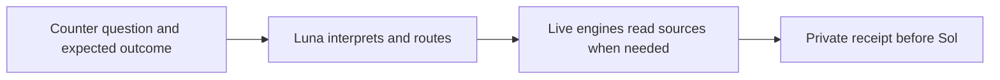
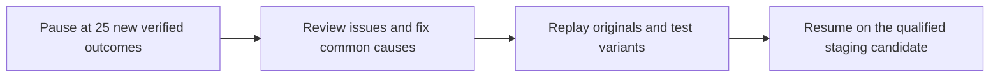
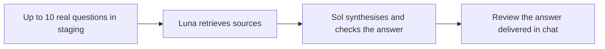

# SOPHIA · Testing in development

As of 19 November 2026. [Visual roadmap in Italian and English](https://sophia-pharmacy.enricogiuliano.chatgpt.site/roadmap#strategia-testing).

## Test Luna v1.2 · Through source reading

Before submission we set the expected outcome for varied practical questions across AIFA, Italian pharmacy legislation, Clinical Evidence, web search and conversation. The 10,000 questions form a candidate corpus. Test Luna stops at its cumulative **USD 20** cap, so the executed count may be lower. Each executed chat has a private receipt with the version, outcome and reason for any interruption. The private detail shows Luna’s original visible output when available.

## Review, fix and retest

At **25 new verified outcomes** the runner pauses submissions. Outcomes count after checking against expectations set in advance. Fixes are verified on the original question, new variants and counterexamples. The campaign resumes on the candidate qualified in staging after the review. Earlier receipts retain their original versions.

## Test completo v1.0 · End-to-end samples

Select varied samples independently of the 25-outcome checkpoint, with a separate cap of **USD 4 per batch**. Review the sources, Sol’s synthesis, the final check and the answer actually delivered. Record gaps, time and interruptions. Apply targeted corrections when needed.

## Deployment and current version checks

**0.7.561** passed **3,886 local tests** and was released to 100% of standard staging and restricted beta traffic. The owner-invited Special Guest route was checked locally. The first actual guest sign-in and a new end-to-end chat evaluation on 0.7.561 remain open. The 0.7.558 results below retain their original version. The regular cadence resumes every 20 versions after this one-off release, starting with 0.7.580.

## Latest observed evidence

- **0.7.556 · Test Luna v1.2.** 49 private preview tests reached 25 newly verified outcomes. The cumulative log contains 5,777 outcomes and 5,748 source-path receipts.
- **0.7.558 · Test completo v1.0.** Ten staging questions yielded five complete outcomes, three partial, one gap and one block. Recorded spend was USD 3.21 against a USD 4 cap. Complete cases include exact pack and original AIFA documents and Normattiva text. One mixed request stopped at final verification.
- **0.7.560 · Private preview.** 3,883 application tests and profile, memory and history continuity checks passed. The scoped credit and signed-review checks used a synthetic account. The prior 0.7.558 end-to-end results retain their version. Counter acceptance and human clinical validation remain open.

## Earlier evidence

Private preview 0.7.529 passed 3,803 app tests and six source-retrieval replays. Test Luna v1.1 on 0.7.528 paused at 25 new verified outcomes. The cumulative log contains 5,462 outcomes and 5,441 receipts. A complete sample from that round answered both parts of a mixed package and legislation question. A clinical sample read relevant abstracts via web fallback and ended with a gap.

Private preview 0.7.524 passed 3,790 app tests. Two complete chats exercised the medicine-substitution legal workflow and preserved the clinical contribution during an AIFA document failure. A separate replay retrieved the leaflet. Test Luna v1.0 on 0.7.524 reached 25 new verified outcomes. The cumulative log includes 5,196 outcomes and 5,180 source-path receipts. Reliability on new questions, counter acceptance, and human clinical validation remain open.

Private preview 0.7.523 passed 3,786 app tests. Replays checked delivery of original AIFA documents from product name and package code, retention of independent sources, and the manufacturer-document route. Test Luna on 0.7.523 reached 25 new verified outcomes. The cumulative log includes 5,119 outcomes and 5,103 source-path receipts. Complete answers on 0.7.523, counter acceptance, and human clinical validation remain open.

Private preview 0.7.522 passed 3,781 app tests and 13 targeted clinical-reader regressions. Replays checked an AIFA leaflet with an omitted title unit, the implementing act on online-sale logos, and retrieval of the authors’ certainty statement for the requested clinical outcome. Test Luna on 0.7.522 reached 25 new verified outcomes. The cumulative log includes 5,006 outcomes and 4,990 source-path receipts. Complete answers on 0.7.522, counter acceptance, and human clinical validation remain open.

Private preview 0.7.521 passed 3,780 local checks and four source replays. Replays verified early bibliographic reading and official text retrieval for online medicine sales. Version 0.7.521 paused at the 25th new verified outcome. The cumulative log contains 4,910 outcomes and 4,894 receipts. The four replays stop before final synthesis.

Private preview 0.7.520 passed 3,777 local checks and six source replays. Replays verified distinct prescription, clinical and product identification scopes, together with product clarification. Version 0.7.520 paused at the 25th new verified outcome. The cumulative log contains 4,817 outcomes and 4,801 receipts. The six replays stop before final synthesis.

Private preview 0.7.519 passed 3,774 local checks and twelve source replays. Replays verified official package and leaflet retrieval, the original text about compounding, and independent clinical evidence in mixed questions. Version 0.7.519 paused at the 25th new verified outcome. The cumulative log contains 4,726 outcomes and 4,710 receipts. The twelve replays stop before final synthesis.

Private preview 0.7.518 passed 3,771 local checks and eight source replays. Replays retained reads during a simulated accounting failure and retrieved the source for online sales authorisation. Version 0.7.518 paused at the 25th new verified outcome. The cumulative log contains 4,608 outcomes and 4,592 receipts. The eight replays stop before final synthesis.

Private preview 0.7.517 passed 3,768 local checks and eight source replays. Replays retrieved advertising rules and clinical sources with an explicit duration limit for the occasional-constipation comparison. Version 0.7.517 paused at the 25th new verified outcome. The cumulative log contains 4,495 outcomes and 4,479 receipts. The eight replays stop before final synthesis.

Private preview 0.7.516 passed 3,763 local checks and six source replays. Clinical retrieval found passages about the requested comparison before Sol. National health service sources distinguish paper prescriptions from electronic metadata. Version 0.7.516 paused at the 25th new verified outcome. The cumulative log contains 4,418 outcomes and 4,406 receipts. The six replays stop before final synthesis.

Private preview 0.7.515 passed 3,759 local checks and six technical replays. The full staging sample on applicator instructions asked for the missing identifier in 10.28 seconds with one Luna call. The mixed sample returned an AIFA leaflet and a partial clinical answer in 177.63 seconds with nine calls. Test Luna paused after 25 new verified outcomes.

Verified outcomes at the checkpoint have frozen expectations for the exact AIFA pack and documents or the official article read. Clinical relevance and unanswered evidence needs are reviewed separately. Running and archiving a chat does not qualify it for the checkpoint.

The restricted beta remains on **0.7.231-beta**, with operational recovery still to be verified. Standard staging is **0.7.453-beta**. [Current state and evidence](STATUS.md).
