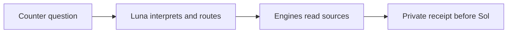
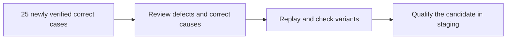
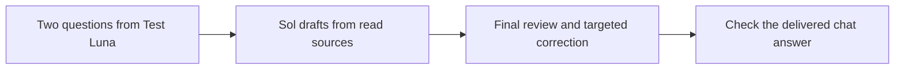

# SOPHIA · Testing in development

As of 19 November 2026. [Visual roadmap in Italian and English](https://sophia-pharmacy.enricogiuliano.chatgpt.site/roadmap.html#strategia-testing).

## Test Luna

Checks cover AIFA, Italian pharmacy legislation and Clinical Evidence, including questions that combine them and relevant web fallbacks. The 10,000-question candidate corpus supplies inputs. Execution stops at the spending limit, so the executed count can be lower. Each executed chat has a private receipt with its version and observed outcome, including gaps and interruptions. The private detail includes Luna’s original visible output when available.

## Correct and retest

Correctness requires checking the observed outcomes against expected findings. At 25 verified outcomes, the runner pauses new submissions. It resumes on a new version after fixes and staging qualification. Fixes are checked on the original and similar questions, including cases that would expose an overly broad correction. The qualified candidate takes over subsequent tests and earlier receipts retain their versions.

## End-to-end samples

Samples assess source support, completeness, concrete gaps, timing and repeatability. Two end-to-end tests on preview 0.7.509 delivered a sourced mixed answer covering AIFA, legislation and Clinical Evidence, and an original patient leaflet with an explicit gap on storage. The 0.7.510 Test Luna block paused early after an original PDF was labelled as an excerpt. Two live-source replays and 3,748 local checks qualified the 0.7.511 preview for the corrected receipt. A full Ultrafast replay remains open.

Verified outcomes at the checkpoint have frozen expectations for the exact AIFA pack and documents or the official article read. Clinical relevance and unanswered evidence needs are reviewed separately. Running and archiving a chat does not qualify it for the checkpoint.

The restricted beta remains on **0.7.231-beta**, with operational recovery still to be verified. Standard staging is **0.7.453-beta**. [Current state and evidence](STATUS.md).
