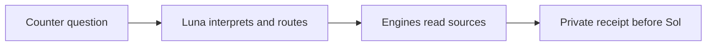
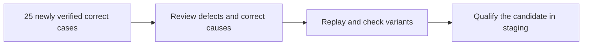
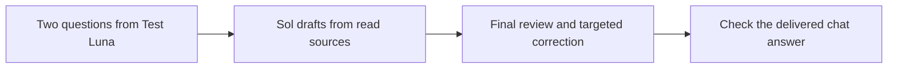

# SOPHIA · Testing in development

As of 19 November 2026. [Visual roadmap in Italian and English](https://sophia-pharmacy.enricogiuliano.chatgpt.site/roadmap.html#strategia-testing).

## Test Luna

Checks cover AIFA, Italian pharmacy legislation and Clinical Evidence, including questions that combine them and relevant web fallbacks. The 10,000-question candidate corpus supplies inputs. Execution stops at the spending limit, so the executed count can be lower. Each executed chat has a private receipt with its version and observed outcome, including gaps and interruptions. The private detail includes Luna’s original visible output when available.

## Correct and retest

Correctness requires checking the observed outcomes against expected findings. At 25 verified outcomes, the runner pauses new submissions. It resumes on a new version after fixes and staging qualification. Fixes are checked on the original and similar questions, including cases that would expose an overly broad correction. The qualified candidate takes over subsequent tests and earlier receipts retain their versions.

## End-to-end samples

Samples assess source support, completeness, concrete gaps, timing and repeatability. The 0.7.495 preview produced one mixed answer with two original AIFA documents and a legal source in 24.84 seconds. A second, clinical answer used a more relevant source and stated the limit of its coverage after a targeted correction, taking 85.53 seconds. These observations concern two specific tests in private preview. Further testing under counter conditions and human clinical validation remain open.

Private preview **0.7.500-beta** passed technical qualification with 3,699 local tests and two AIFA document-retrieval replays. The changes preserve explicitly requested AIFA documents in mixed questions and limit repeated review of an unchanged draft. End-to-end testing on 0.7.500 remains open.

The restricted beta remains on **0.7.231-beta**, with operational recovery still to be verified. Standard staging is **0.7.453-beta**. [Current state and evidence](STATUS.md).
