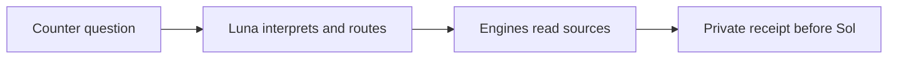
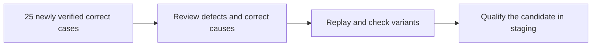
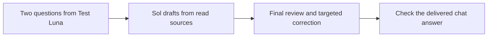

# SOPHIA · Testing in development

As of 19 November 2026. [Visual roadmap in Italian and English](https://sophia-pharmacy.enricogiuliano.chatgpt.site/roadmap.html#strategia-testing).

## Test Luna

Checks cover AIFA, Italian pharmacy legislation and Clinical Evidence, including questions that combine them and relevant web fallbacks. The 10,000-question candidate corpus supplies inputs. Execution stops at the spending limit, so the executed count can be lower. Each executed chat has a private receipt with its version and observed outcome, including gaps and interruptions. The private detail includes Luna’s original visible output when available.

## Correct and retest

Correctness requires checking the observed outcomes against expected findings. At 25 verified outcomes, the runner pauses new submissions. It resumes on a new version after fixes and staging qualification. Fixes are checked on the original and similar questions, including cases that would expose an overly broad correction. The qualified candidate takes over subsequent tests and earlier receipts retain their versions.

## End-to-end samples

Samples assess source support, completeness, concrete gaps, timing and repeatability. Private preview 0.7.522 passed 3,781 app tests and 13 targeted clinical-reader regressions. Replays checked an AIFA leaflet with an omitted title unit, the implementing act on online-sale logos, and retrieval of the authors’ certainty statement for the requested clinical outcome. Test Luna on 0.7.522 reached 25 new verified outcomes. The cumulative log includes 5,006 outcomes and 4,990 source-path receipts. Complete answers on 0.7.522, counter acceptance, and human clinical validation remain open.

Private preview 0.7.521 passed 3,780 local checks and four source replays. Replays verified early bibliographic reading and official text retrieval for online medicine sales. Version 0.7.521 paused at the 25th new verified outcome. The cumulative log contains 4,910 outcomes and 4,894 receipts. The four replays stop before final synthesis.

Private preview 0.7.520 passed 3,777 local checks and six source replays. Replays verified distinct prescription, clinical and product identification scopes, together with product clarification. Version 0.7.520 paused at the 25th new verified outcome. The cumulative log contains 4,817 outcomes and 4,801 receipts. The six replays stop before final synthesis.

Private preview 0.7.519 passed 3,774 local checks and twelve source replays. Replays verified official package and leaflet retrieval, the original text about compounding, and independent clinical evidence in mixed questions. Version 0.7.519 paused at the 25th new verified outcome. The cumulative log contains 4,726 outcomes and 4,710 receipts. The twelve replays stop before final synthesis.

Private preview 0.7.518 passed 3,771 local checks and eight source replays. Replays retained reads during a simulated accounting failure and retrieved the source for online sales authorisation. Version 0.7.518 paused at the 25th new verified outcome. The cumulative log contains 4,608 outcomes and 4,592 receipts. The eight replays stop before final synthesis.

Private preview 0.7.517 passed 3,768 local checks and eight source replays. Replays retrieved advertising rules and clinical sources with an explicit duration limit for the occasional-constipation comparison. Version 0.7.517 paused at the 25th new verified outcome. The cumulative log contains 4,495 outcomes and 4,479 receipts. The eight replays stop before final synthesis.

Private preview 0.7.516 passed 3,763 local checks and six source replays. Clinical retrieval found passages about the requested comparison before Sol. National health service sources distinguish paper prescriptions from electronic metadata. Version 0.7.516 paused at the 25th new verified outcome. The cumulative log contains 4,418 outcomes and 4,406 receipts. The six replays stop before final synthesis.

Private preview 0.7.515 passed 3,759 local checks and six technical replays. The full staging sample on applicator instructions asked for the missing identifier in 10.28 seconds with one Luna call. The mixed sample returned an AIFA leaflet and a partial clinical answer in 177.63 seconds with nine calls. Test Luna paused after 25 new verified outcomes.

Verified outcomes at the checkpoint have frozen expectations for the exact AIFA pack and documents or the official article read. Clinical relevance and unanswered evidence needs are reviewed separately. Running and archiving a chat does not qualify it for the checkpoint.

The restricted beta remains on **0.7.231-beta**, with operational recovery still to be verified. Standard staging is **0.7.453-beta**. [Current state and evidence](STATUS.md).
